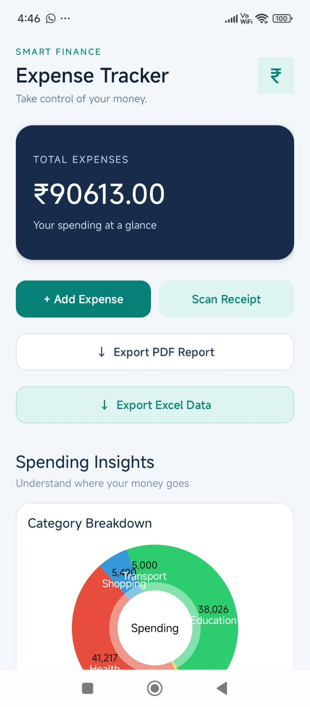
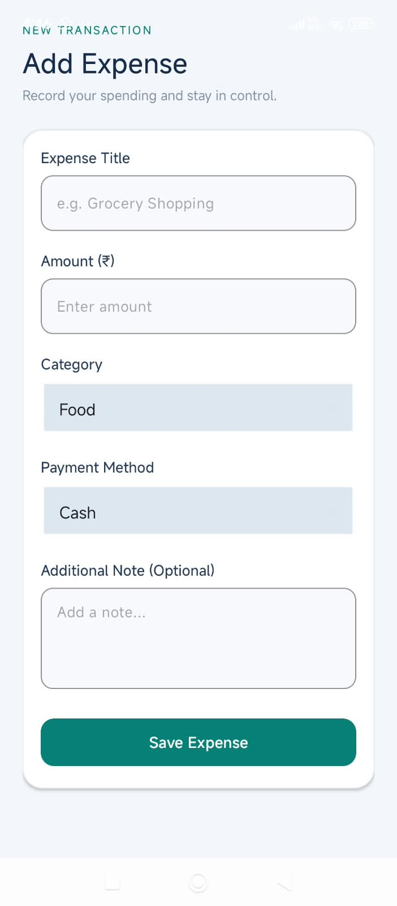
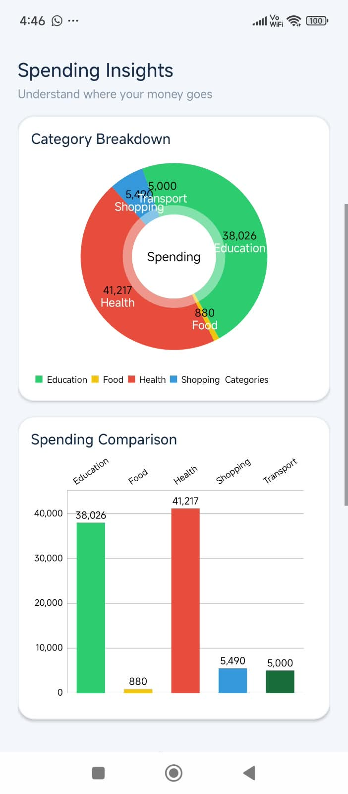
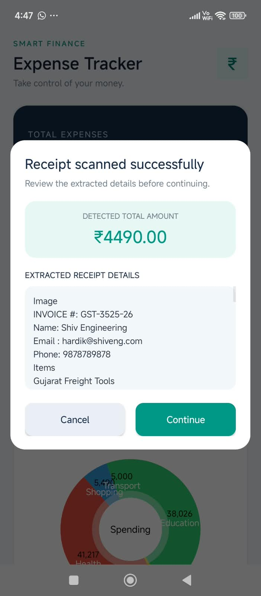
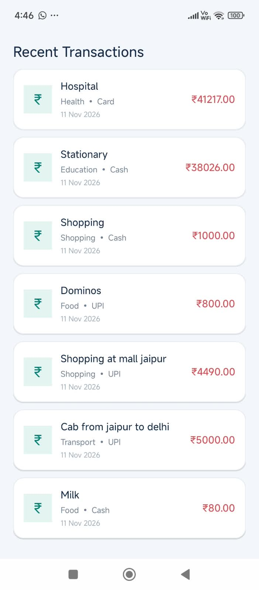
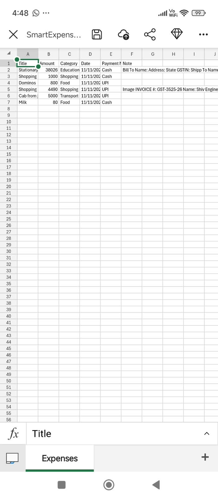
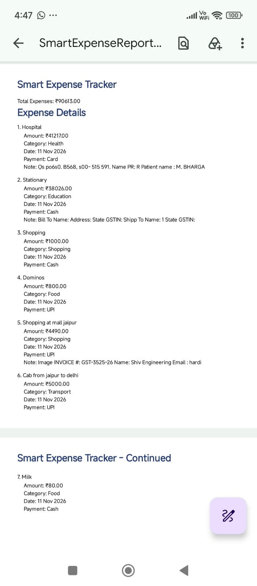

# Smart Expense Tracker – Android App

A feature-rich Android application designed to help users manage, track, and analyze their daily expenses.

## Features

- **Expense Management:** Add and save expenses with title, amount, category, date, payment method, and notes.
- **Room Database:** Store and retrieve expense records locally.
- **Expense Dashboard:** View total expenses and recent transactions.
- **Expense Analytics:** Visualize spending patterns using Pie Charts and Bar Charts.
- **Receipt Scanning (OCR):** Extract receipt text and detected amounts using Google ML Kit.
- **PDF Export:** Generate and save expense reports in PDF format.
- **Excel Export:** Export expense records into `.xlsx` spreadsheets.

## Technologies Used

- Kotlin
- Android Studio
- XML Layouts
- Room Database
- Kotlin Coroutines and Flow
- MPAndroidChart
- Google ML Kit Text Recognition
- Android Storage Access Framework
- PDF Generation
- Excel XLSX Export

## Project Structure

- `data/` – Room database, entities, DAO, and export utilities.
- `MainActivity.kt` – Dashboard, charts, OCR scanning, and export actions.
- `AddExpenseActivity.kt` – Add and save expense records.
- `res/layout/` – Application UI layouts.

## Screenshots

### 1. Dashboard

### 2. Add Expense

### 3. Analytics

### 4. Receipt Scanner

### 5. Transactions

### 6. Export as Excel

### 7. Export as PDF

## Installation

1. Clone this repository.
2. Open the project in Android Studio.
3. Allow Gradle sync to complete.
4. Connect an Android device or start an emulator.
5. Run the application.

## Project Purpose

This project was developed as part of an Android Development Internship to demonstrate practical skills in Kotlin, database management, OCR integration, data visualization, and report generation.

## Developer

Android Development Project – Smart Expense Tracker
